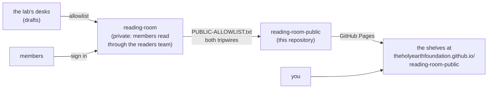

<picture>
  <source media="(prefers-color-scheme: dark)" srcset="https://raw.githubusercontent.com/theholyearthfoundation/.github/main/profile/assets/banner-dark.svg">
  
</picture>

#  The Holy Earth Foundation — Reading room, public

*The proposals, procedures and decks the foundation is ready to show, with a front end at*
***<https://theholyearthfoundation.github.io/reading-room-public/>***

**[ Members: enter the reading room](https://github.com/theholyearthfoundation/reading-room)** (sign in to GitHub first)

---

##  What this is

The foundation's members read drafts in a private reading room. When an officer decides a page is ready for
visitors, it is added to that room's allowlist and copied here, and this repository's GitHub Pages site lists it on a
shelf. Until then the shelves say where each piece waits.

##  What is here

| File | Owned by | What it does |
|---|---|---|
| `index.html`, `assets/`, `.nojekyll` | this repository | the front end: one static page in the foundation's amber, no build step, readable on a phone, light and dark |
| `README.md` | this repository | this page |
| `room-manifest.json` | the sync | the list of files the sync copied, read by the front end (absent until the first sync) |
| `proposals/`, `procedures/`, `decks/` | the sync | only the paths an officer has allowlisted: *Start here* and the procedures every organisation in the fleet shares are listed; they arrive on the first sync after the deploy key exists |

##  How it is kept

- **Nobody edits the synced folders by hand.** The private room's sync copies exactly its allowlisted paths after two
  tripwires: the first stops anything that looks like a credential or an internal note; the second reads **every**
  file, PDFs included, and refuses one that no machine could read unless a person attested they read it. A public
  lane never publishes a file a machine or a person has not read (SOP-OPS-003). The front end's own files are never
  overwritten by it.
- `main` cannot be deleted (a deletion-only ruleset). Pages builds from `main`, at the root.
- To change the front end, open a pull request here; to change what is published, change the allowlist in the private room.

##  Reading the members' room

The members' room is <https://github.com/theholyearthfoundation/reading-room>. Members of the foundation send their
GitHub username (never a password or a code) to the steward or to Kenney, accept the invitation, and read the private
room in a browser. A **404** there means "not yet invited" or "signed out", not "broken". New to GitHub? The
procedure *New to GitHub: your first hour* (SOP-COM-001) walks the whole first hour; the page's *Read the members'
room* section has the short version.

##  Elsewhere

-  [The foundation →](https://theholyearthfoundation.github.io)
-  [Welcome to The Holy Earth Foundation](https://github.com/theholyearthfoundation/.github/blob/main/decks/welcome.marp.pdf), the welcome deck
-  The procedures' public twin: [`ops-standard-operating-procedures-public`](https://github.com/theholyearthfoundation/ops-standard-operating-procedures-public)
-  The lab's public proposals preview: [`drasticstatic/proposals-thef-public-preview`](https://github.com/drasticstatic/proposals-thef-public-preview)
