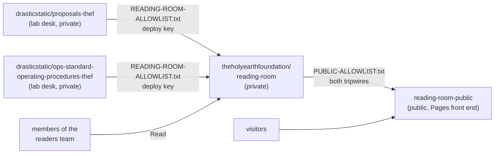

# SOP-IT-002 · Reading room and helper access: browser first, a token only if needed

**Department:** IT · **ID:** 002 · **Status:** draft (approved when tagged) · **Owner:** organisation administrator · **Last changed:** 2026-11-01

##  Purpose
The steps a member follows to read an organisation's private repositories, and the steps for letting an AI helper read the same selected material, with the smallest credential that fits. The reasoning lives in proposal THEF 012 and in `my-template/org-onboarding/ACCESS-AND-PATS.md`; this is only the procedure.

##  Scope
Any person given access to an organisation's private repositories, and their helper. Not for treasury keys, recovery codes or passwords.

##  Roles
| Role | Does |
|---|---|
| Member | signs in, reads, asks for a helper if wanted |
| Administrator | invites, approves token requests, verifies as the member |
| Helper | reads only what it is granted; never receives a secret in chat |

##  Steps: read as yourself
1. Sign in to GitHub with your own account and two-factor authentication on. *You should see:* your avatar top right.
2. Accept the organisation invitation (email or the bell icon). *You should see:* the organisation under your profile's Organizations.
3. Open the repository link you were given, then one README and its PDF under `pdf/`. *You should see:* the page, not a 404. A 404 on a private link means permission is absent: tell the administrator which account you are signed in as.
4. Reply where you already talk to the organisation, or open an Issue if your role allows.

##  Steps: bring a helper, optionally
1. Ask whether the helper already has an approved GitHub connection that reaches the repository. *If yes:* stop here.
2. If a credential is required, create a **fine-grained personal access token** in your own account: resource owner = the organisation; only the repositories needed; **Contents: Read-only** (plus the metadata GitHub requires); a short expiry. *You should see:* the token once; copy it only into the helper's own credential store.
3. The administrator approves the request if the organisation requires approval. *You should see:* the token's status change from pending to active.
4. Ask the helper to read one named README and summarise it without changing anything. *You should see:* a correct summary and no commit.
5. Record owner, purpose, repositories, expiry and who can revoke, in the organisation's private onboarding notes. Never the token.
6. Revoke or rotate when the purpose ends, the role changes, a device is lost, or exposure is suspected.

##  The reading-room route (organisation-owned)
A **reading room** is where an organisation's people read drafts that are not public yet, with a public room beside it for what is ready for visitors. The Holy Earth Foundation's addresses are filled in below; link this table from the foundation's `.github` README and its onboarding page.



The sync's rule and the tripwires are in SOP-OPS-003; the readers team and the base permission in SOP-GOV-002.

(Every repository named here belongs to `theholyearthfoundation`, except the two lab desks, which are `drasticstatic`'s.)

| Piece | What it is | The Holy Earth Foundation |
|---|---|---|
| Private room | `theholyearthfoundation/reading-room`: an **organisation-owned** private repository holding the drafts the foundation's people may read (`proposals/`, `procedures/`, `decks/`). Its README is the index; PDFs sit beside the markdown | <https://github.com/theholyearthfoundation/reading-room> |
| Readers team | `theholyearthfoundation/readers`, a closed team with **Read** on the private room and nothing else | <https://github.com/orgs/theholyearthfoundation/teams/readers> |
| Public room | `theholyearthfoundation/reading-room-public`: a public repository that receives **only allowlisted pages** from the private room, with a GitHub Pages front end in amber | <https://theholyearthfoundation.github.io/reading-room-public/> (repository: <https://github.com/theholyearthfoundation/reading-room-public>) |
| How drafts arrive | from the lab's desks (`drasticstatic/proposals-thef` into `proposals/lab-desk/`, `drasticstatic/ops-standard-operating-procedures-thef` into `procedures/lab-desk/`), each listing its paths in `READING-ROOM-ALLOWLIST.txt` and pushing through the deploy key `READING_ROOM_DEPLOY_KEY`; from the private room to the public room, `PUBLIC-ALLOWLIST.txt` and `READING_ROOM_PUBLIC_DEPLOY_KEY`. Tripwire first, never hand edits | each source repository's allowlist file |
| Procedures' public twin | `theholyearthfoundation/ops-standard-operating-procedures-public`: this repository's allowlisted procedures (`PUBLIC-ALLOWLIST.txt`, deploy key `SOP_PUBLIC_DEPLOY_KEY`) | <https://github.com/theholyearthfoundation/ops-standard-operating-procedures-public> |

> [!NOTE]
> **State on 2026-11-01 (read through the API).** `reading-room` (private), `reading-room-public` (public, Pages built at
> the address above) and `ops-standard-operating-procedures-public` exist. `readers` (closed) holds Read on `reading-room`
> and nothing else. Both public lanes carry the deletion-only ruleset. The organisation's base permission is **No
> permission** (SOP-GOV-002), so the `readers` team is the only door for a member who is not an owner. **Still to come:**
> the deploy keys, so every sync is inert today; `PUBLIC-ALLOWLIST.txt` lists the procedures every organisation shares
> and the icons, and they travel on the first run after `SOP_PUBLIC_DEPLOY_KEY` exists.

Why organisation-owned: a personal private repository cannot give anyone read-only access (the 422 below), and Pages on a private repository publishes **publicly** on the free plan, so a members-only website is not available today. The private room's front end is therefore the repository itself (README index, PDFs, decks); the public room is the website. A members-only site (an access gate in front of a Pages build, or GitHub Enterprise) is the later option.

###  Steps: steward (once per organisation)
1. Create both rooms (an owner's action): `gh repo create theholyearthfoundation/reading-room --private` and `gh repo create theholyearthfoundation/reading-room-public --public` (or push the prepared folders with `--source . --push`). *You should see:* both under the organisation's repositories.
2. Create the team and grant Read on the private room only:
   ```sh
   gh api -X POST orgs/theholyearthfoundation/teams -f name=readers -f privacy=closed
   gh api -X PUT orgs/theholyearthfoundation/teams/readers/repos/theholyearthfoundation/reading-room -f permission=pull
   ```
3. Add readers on an officer's yes: `gh api -X PUT orgs/theholyearthfoundation/teams/readers/memberships/<login>` (the same shape as SOP-GOV-001).
4. Give the public room a deletion-only ruleset (nobody edits it by hand and only the sync writes to it; SOP-OPS-002 legend) and turn on Pages from `main` / (root).
5. Keep the table above current (it holds the real addresses); link it from the foundation's `.github` README. Provision the three deploy keys when the officers want the syncs live (the commands are at the top of each sync workflow).

###  Steps: reader
1. Accept the organisation invitation and the team, then open the private room's README. *You should see:* the index, not a 404.
2. Read in the browser, or open a PDF from `pdf/`. To bring a helper, follow *bring a helper* above, choosing only `reading-room` in the token's repository selection.

##  Verification
The member opens the page from their own account; the helper's read test passes; the administrator can see the token under the organisation's personal access tokens with the expected scope.

##  Troubleshooting
| Symptom | Likely cause | What to do |
|---|---|---|
| A read-only invitation to a personal (not organisation) private repository fails with 422 | GitHub offers no read-only collaborator on personal repositories | use the organisation-owned repository as the door; never grant write and call it read-only |
| The token works for public repositories only | approval pending | the administrator approves it |
| The helper cannot reach a repository the member can | token's repository selection excludes it, or an outside-collaborator limitation | adjust selection, or move to organisation membership / an approved GitHub App |

##  Related
- SOP-COM-001 *New to GitHub: your first hour* (where a newcomer starts), SOP-GOV-002 *GitHub collaboration*, SOP-OPS-003 *Private houses everything, public lanes witness*
- Proposal: THEF 012 *Your reading room, and how your helper joins you*
- `my-template/org-onboarding/ACCESS-AND-PATS.md`
- SOP-OPS-002 (a helper opens pull requests but does not merge; the legend), SOP-GOV-001 (the Board's room uses the same team shape)
- `my-template/workflow-templates/sync-public-allowlist.yml` (the fleet's sync shape); here, `scripts/sync-allowlist.sh` (stage, tripwire, apply) and `.github/workflows/sync-public.yml`

##  Change log
| Date | Change | By |
|---|---|---|
| 2026-10-30 | Drafted from Littlebird's access draft and the Oct 30 verification | Alfred |
| 2026-10-31 | The generic reading-room route: an organisation-owned private room, a readers team with Read, a public room with a Pages front end, a fill-in address table | Alfred |
| 2026-11-01 | Lucid pass: Lucide icons, the route drawn in Mermaid; links to SOP-OPS-003 (the tripwires) and SOP-GOV-002 (teams, base permission none); new readers start at SOP-COM-001 | Alfred |
| 2026-10-31 | Filled in for The Holy Earth Foundation: the real addresses, the lab-desk and public sync paths, the procedures' public twin, the state of the day | Alfred |
| 2026-11-01 | THEF: the lucid pass merged in; the route drawn for the foundation's own repositories; the state box re-read (rooms and twin live, Pages built, deletion-only rulesets, base permission No permission, deploy keys still to come) | Alfred |
